# AppAudit: Comprehensive Architecture & Execution Flow Graphs

This document details the architectural blueprints, execution pipelines, data paths, decision trees, and service relationships within **AppAudit**. Every major workflow is paired with a visual **Mermaid.js** diagram and plain-English operational explanations.

---

## Table of Contents

1. [Master System Topology (Full Application Graph)](#1-master-system-topology-full-application-graph)
2. [Complete Forensic Triage Decision Tree (The Core Engine Flow)](#2-complete-forensic-triage-decision-tree-the-core-engine-flow)
3. [Web Dashboard & Scan Target Flows (All 4 Scan Modes)](#3-web-dashboard--scan-target-flows-all-4-scan-modes)
   - [3.1 Single File Upload (`POST /api/v1/audit/upload`)](#31-single-file-upload-post-apiv1auditupload)
   - [3.2 Host Quick Scan (`POST /api/v1/audit/quick`)](#32-host-quick-scan-post-apiv1auditquick)
   - [3.3 Deep Host Scan (`POST /api/v1/audit/full`)](#33-deep-host-scan-post-apiv1auditfull)
   - [3.4 Custom Directory Audit (`POST /api/v1/audit/directory`)](#34-custom-directory-audit-post-apiv1auditdirectory)
4. [Multi-Engine Comparison Benchmark Flow (`POST /api/v1/audit/compare`)](#4-multi-engine-comparison-benchmark-flow-post-apiv1auditcompare)
5. [AI Provider & Local Service Supervision Flow](#5-ai-provider--local-service-supervision-flow)
6. [Cache Architecture & Dual-Tier Logging Flow](#6-cache-architecture--dual-tier-logging-flow)
   - [6.1 4-Store Cache Lifecycle](#61-4-store-cache-lifecycle)
   - [6.2 Dual-Tier Logging & PII Masking Pipeline](#62-dual-tier-logging--pii-masking-pipeline)
7. [Complete CLI Subcommand Routing Graph](#7-complete-cli-subcommand-routing-graph)

---

## 1. Master System Topology (Full Application Graph)

The following diagram illustrates how all components, entry points, packages, background supervisors, and caches interact across the application boundary.

```mermaid
flowchart TD
    subgraph Users ["Client Interaction Channels"]
        CLI_User["CLI Terminal User"]
        Browser_User["Web Browser Client (Chrome / Edge / Firefox)"]
    end

    subgraph Entrypoints ["Application Entrypoints"]
        Main["cmd/audit/main.go (CLI Dispatcher & Interactive Wizard)"]
        ServerCore["internal/server/server.go (Strict Loopback: 127.0.0.1:8085)"]
    end

    subgraph WebApp ["Embedded Presentation Layer"]
        IndexHTML["internal/server/web/index.html (Single-File Glassmorphic UI)"]
        DialogWindows["internal/server/dialog_windows.go (Native COM IFileDialog Picker)"]
    end

    subgraph ServerHandlers ["HTTP API Route Handlers (internal/server)"]
        H_Audit["handlers_audit.go (/api/v1/audit/*, /api/v1/preflight/stats)"]
        H_Compare["handlers_compare.go (/api/v1/audit/compare)"]
        H_System["handlers_system.go (/api/v1/health, cache, company, config, dialog)"]
        LoggingCore["logging.go (MaskPII, Dual-Tier Logger, Request Telemetry)"]
    end

    subgraph CoreEngine ["Application Engine (internal/application)"]
        Engine["engine.go (Worker Pools, Parallel Coordination, Chunking)"]
        DecisionTree["decision.go (Multi-Tier Forensic Triage & Grounding Gate)"]
        IdentityEngine["identity.go (Package Name, Publisher & Version Resolution)"]
        Reconciler["reconciler.go (Multi-Binary Executable Grouping)"]
        CompanyManifest["manifest.go (In-House Corporate Software Registry)"]
    end

    subgraph Discovery ["Host Discovery & Crawlers"]
        ScannerWindows["internal/scanner/scanner_windows.go (Registry, Start Menu, PATH)"]
        Crawler["internal/discovery/scanner.go (Recursive Filesystem Walker)"]
        Collector["internal/discovery/collector.go (Targeted Folder Roots)"]
    end

    subgraph Forensics ["Binary Forensic Extractors (internal/provenance)"]
        PE_Inspector["inspector_pe.go (Authenticode, Cert Chains, .rsrc Strings)"]
        Build_Inspector["inspect_build.go (Go Compiler debug/buildinfo Metadata)"]
        Pkg_Inspector["inspector_pkgmgr.go (Scoop, Cargo, Chocolatey, Winget)"]
        Runtime_Inspector["inspector_runtime.go (Python dist-info, Node package.json)"]
        Strings_Inspector["inspector_strings.go (.rdata Public Git URLs, VersionInfo)"]
        CIRCL_Client["client_hashlookup.go (CIRCL Hashlookup Client & Circuit Breaker)"]
        ProvCache["cache.go (Thread-Safe SHA-256 Provenance Cache)"]
    end

    subgraph AI_Reasoning ["AI Grounding & Reasoning (internal/ai)"]
        NoopAI["noop.go (Deterministic Mode: 0 Tokens, 0ms)"]
        GeminiClient["gemini.go (Google Gemini + Google Search Grounding)"]
        DeepSeekClient["deepseek.go (DeepSeek Cloud Reasoning & Web Search)"]
        OllamaClient["ollama.go (Local Ollama LLM + SearXNG Grounding)"]
        PromptMgr["prompt.go (Dynamic System Prompts & Few-Shot Instruction)"]
        AICache["cache.go (Persistent Disk & In-Memory AI Verdict Caches)"]
    end

    subgraph Supervision ["Background Service Supervisor (internal/service)"]
        Supervisor["supervisor.go (Ollama GPU Check & SearXNG Docker Auto-Boot)"]
    end

    %% Flows
    CLI_User -->|Launches scan / analyze / config| Main
    Browser_User -->|Accesses http://127.0.0.1:8085| ServerCore
    Main -->|Subcommand: serve / web| ServerCore
    Main -->|Subcommand: scan / analyze| Engine

    ServerCore --> IndexHTML
    ServerCore --> H_Audit
    ServerCore --> H_Compare
    ServerCore --> H_System

    H_System --> DialogWindows
    H_System --> LoggingCore
    H_Audit --> LoggingCore
    H_Compare --> LoggingCore

    H_Audit --> Engine
    H_Compare --> Engine
    H_System --> CompanyManifest
    H_System --> AICache
    H_System --> ProvCache

    Engine --> ScannerWindows
    Engine --> Crawler
    Engine --> Collector
    Engine --> Reconciler
    Engine --> DecisionTree

    DecisionTree --> IdentityEngine
    DecisionTree --> CompanyManifest
    DecisionTree --> PE_Inspector
    DecisionTree --> Build_Inspector
    DecisionTree --> Pkg_Inspector
    DecisionTree --> Runtime_Inspector
    DecisionTree --> Strings_Inspector
    DecisionTree --> CIRCL_Client
    DecisionTree --> ProvCache

    DecisionTree -->|Unresolved fallback| NoopAI
    DecisionTree -->|Unresolved fallback| GeminiClient
    DecisionTree -->|Unresolved fallback| DeepSeekClient
    DecisionTree -->|Unresolved fallback| OllamaClient

    GeminiClient --> AICache
    DeepSeekClient --> AICache
    OllamaClient --> AICache
    OllamaClient --> Supervisor
    GeminiClient --> PromptMgr
    DeepSeekClient --> PromptMgr
    OllamaClient --> PromptMgr
```

### Explanation of System Topology

- **Dual Interaction Interfaces**: Users can interact through the interactive terminal CLI (`audit.exe scan`, `audit.exe cli`) or launch the embedded translucent desktop web app (`audit.exe web` or `audit.exe serve`).
- **Strict Loopback Binding**: The web dashboard is locked to `127.0.0.1:8085`. It rejects external network connections, preventing firewall security alerts and eliminating unauthorized LAN access.
- **Engine Coordination**: The `internal/application/engine.go` acts as the central conductor. It coordinates host discovery (`internal/scanner`), disk directory crawling (`internal/discovery`), binary forensic decomposition (`internal/provenance`), and optional AI reasoning models (`internal/ai`).
- **Resilient Fallback Design**: If an AI backend is slow, unconfigured, or offline, the supervisor (`internal/service`) and decision tree (`internal/application/decision.go`) smoothly fall back to deterministic cryptographic rules with zero system crashes.

---

## 2. Complete Forensic Triage Decision Tree (The Core Engine Flow)

The decision engine evaluates binaries through a hierarchical 4-stage pipeline. The moment definitive proof is established at an upper layer, analysis **immediately early exits**, saving CPU time and avoiding unnecessary API roundtrips.

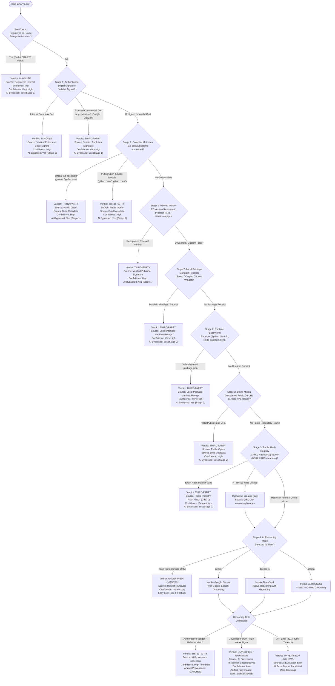

### Forensic Stages Explained

1. **Enterprise Manifest Pre-Check**: Checks `company_manifest.json` for paths or hashes explicitly registered by administrator teams. Matches resolve immediately as `IN_HOUSE` in 0ms.
2. **Stage 1 (Cryptographic & Compiler Layer)**: Inspects Authenticode certificates via WinTrust APIs, embedded Go toolchain markers, and valid PE VersionInfo resources.
3. **Stage 2 (Local Receipt & String Mining)**: Checks Scoop app directories, Cargo crates registries, Chocolatey manifests, Python `dist-info`, and `.rdata` read-only section strings for repository URLs.
4. **Stage 3 (Public Hash Registry)**: Queries the CIRCL Hashlookup API (NSRL/RDS repository). If the server returns HTTP 429 (Too Many Requests), a circuit breaker trips for 60 seconds to maintain scan velocity.
5. **Stage 4 (AI Reasoning & Grounding Gate)**: When deterministic steps are inconclusive, the binary evidence bundle is routed to the selected AI provider. The strict **Grounding Gate** rejects subjective forum claims and only accepts verified publisher domains or exact cryptographic asset releases.

---

## 3. Web Dashboard & Scan Target Flows (All 4 Scan Modes)

### 3.1 Single File Upload (`POST /api/v1/audit/upload`)

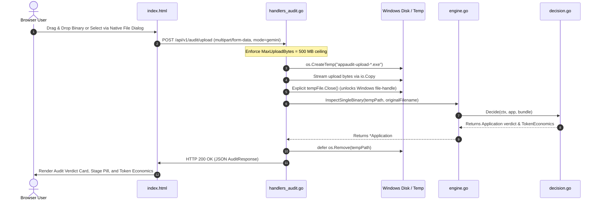

### 3.2 Host Quick Scan (`POST /api/v1/audit/quick`)

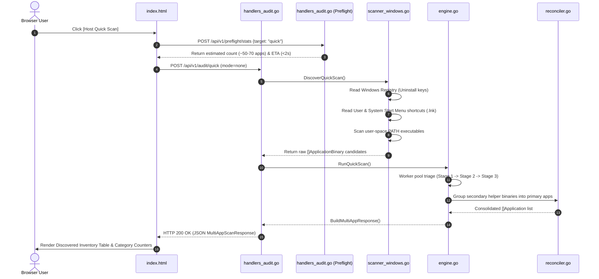

### 3.3 Deep Host Scan (`POST /api/v1/audit/full`)

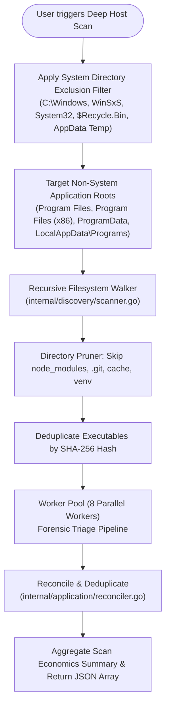

### 3.4 Custom Directory Audit (`POST /api/v1/audit/directory`)

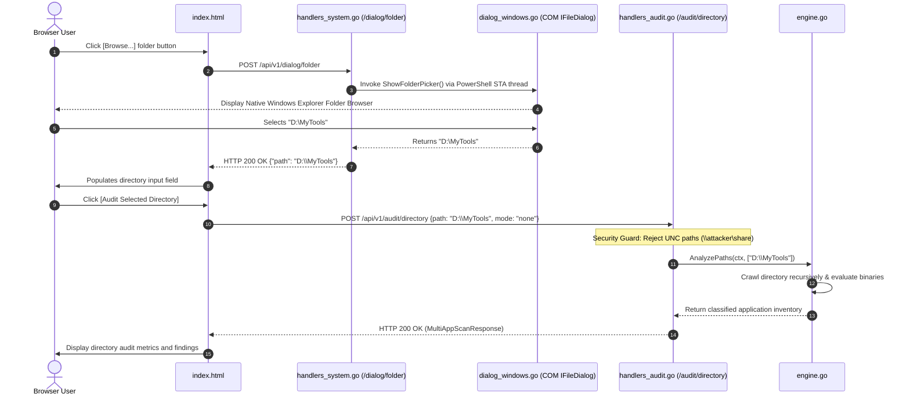

---

## 4. Multi-Engine Comparison Benchmark Flow (`POST /api/v1/audit/compare`)

The Comparison Benchmark allows cross-evaluating multiple reasoning engines (Deterministic, Ollama, Gemini, DeepSeek) against identical software applications.

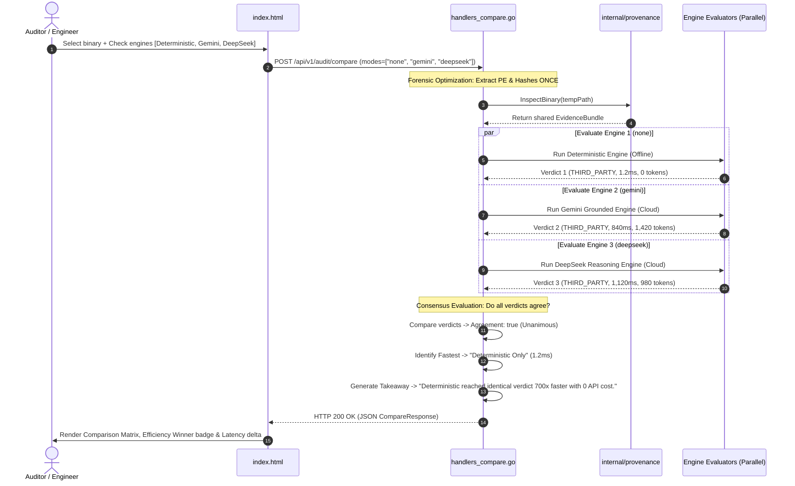

---

## 5. AI Provider & Local Service Supervision Flow

This diagram illustrates how AppAudit manages cloud AI endpoints and automatically provisions local offline LLM/Search stacks.

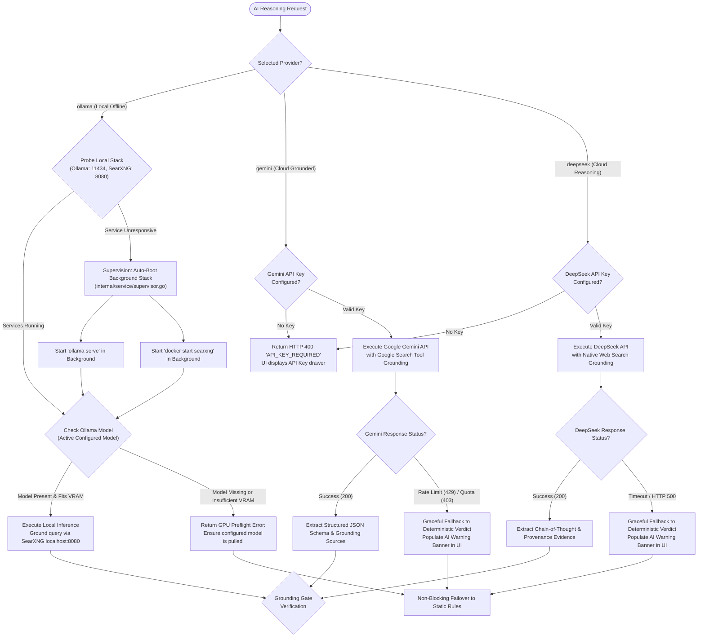

---

## 6. Cache Architecture & Dual-Tier Logging Flow

### 6.1 4-Store Cache Lifecycle

AppAudit implements 4 isolated cache stores to eliminate redundant external calls, minimize egress, and enable atomic purges.

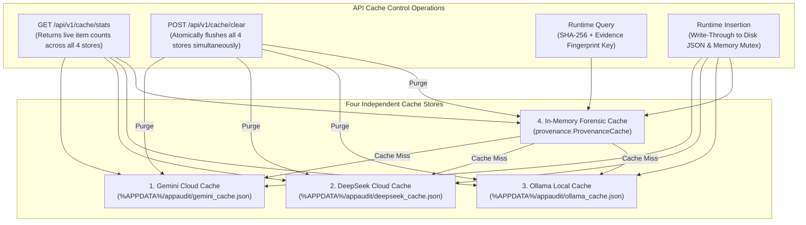

### 6.2 Dual-Tier Logging & PII Masking Pipeline

Every system event is split into two distinct tiers: friendly sanitized events for browser clients and diagnostic sanitized logs for terminal operators.

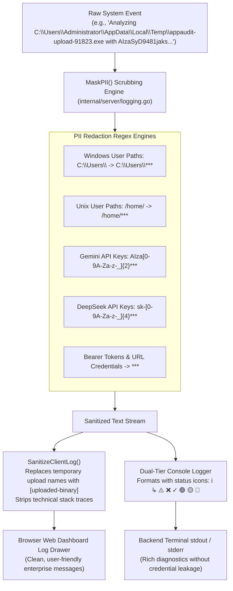

---

## 7. Complete CLI Subcommand Routing Graph

The CLI binary (`audit.exe`) supports direct automation, batch analysis, service management, and credential administration:

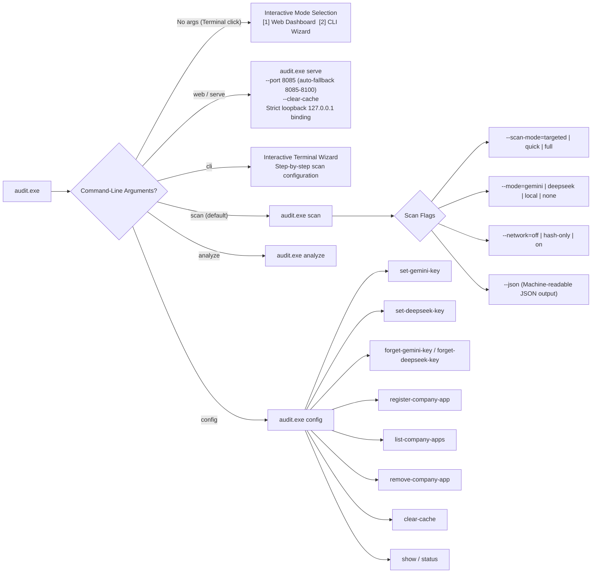

### CLI Command Summary

| Command | Primary Use Case | Key Flags |
| :--- | :--- | :--- |
| `audit.exe` | Default interactive launch when double-clicked or invoked without arguments. | Automatically opens terminal menu. |
| `audit.exe web` / `serve` | Launches local desktop HTTP server and opens browser. | `--port 8085`, `--searxng-url`, `--verbose` |
| `audit.exe scan` | Executes automated discovery scan across installed applications. | `--scan-mode=targeted`, `--mode=gemini`, `--json` |
| `audit.exe analyze <path>` | Evaluates a single executable or specific directory. | `--mode=none`, `--mode=gemini` |
| `audit.exe config` | Configures persistent API keys, manifest entries, and caches. | `set-gemini-key`, `register-company-app`, `clear-cache` |
| `audit.exe cli` | Terminal-based interactive wizard for headless environments. | Guided prompt interface. |

---

## 8. Summary of Engineering Highlights

- **0ms Early Exits**: Up to 95% of standard commercial binaries resolve deterministically at Stage 1 and Stage 2 without contacting cloud AI endpoints or public networks.
- **Leak-Proof Localhost Binding**: The HTTP server binds exclusively to `127.0.0.1`, shielding internal endpoints from corporate Wi-Fi or LAN discovery.
- **Fail-Safe AI Integration**: External API failures (rate limits, network down, missing keys) do not halt execution; the engine reports non-blocking diagnostics and cleanly falls back to deterministic static verdicts.
- **Zero-Footprint Git Hygiene**: Test corpora (`testdata/corpus/`), temporary spools, and binary artifacts are comprehensively excluded in `.gitignore` to keep source repositories lightweight and distribution-ready.
